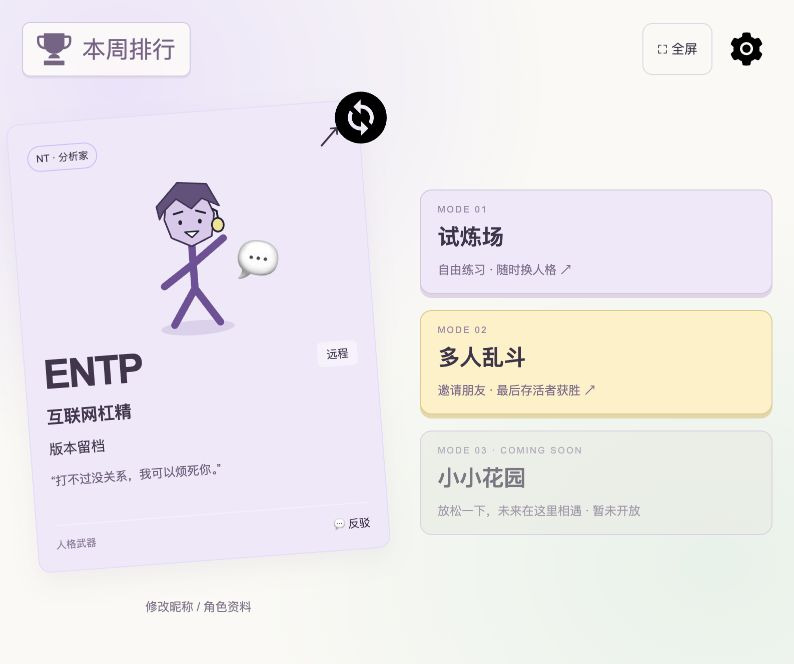
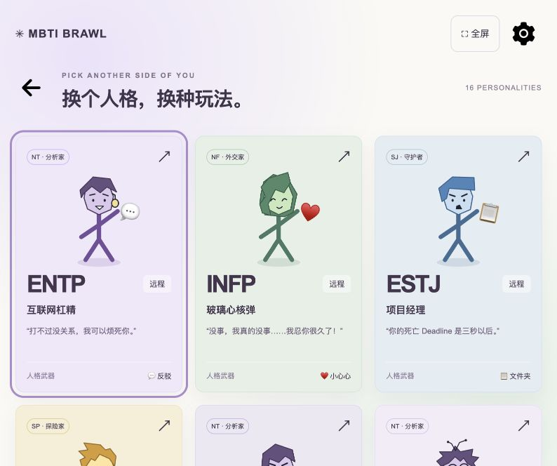
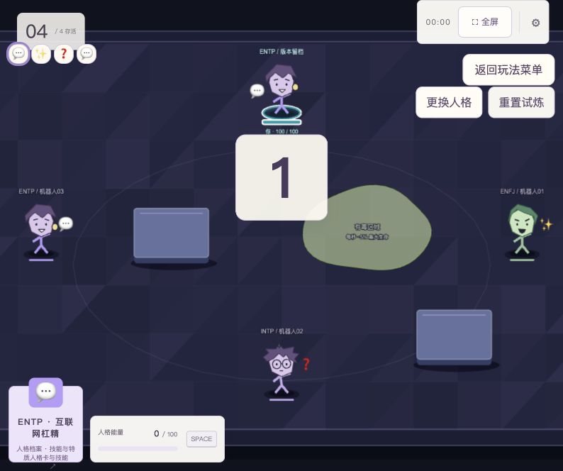
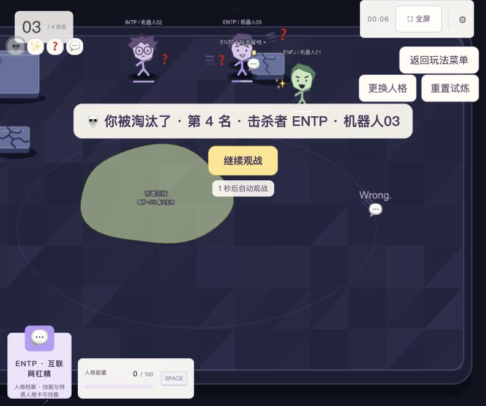
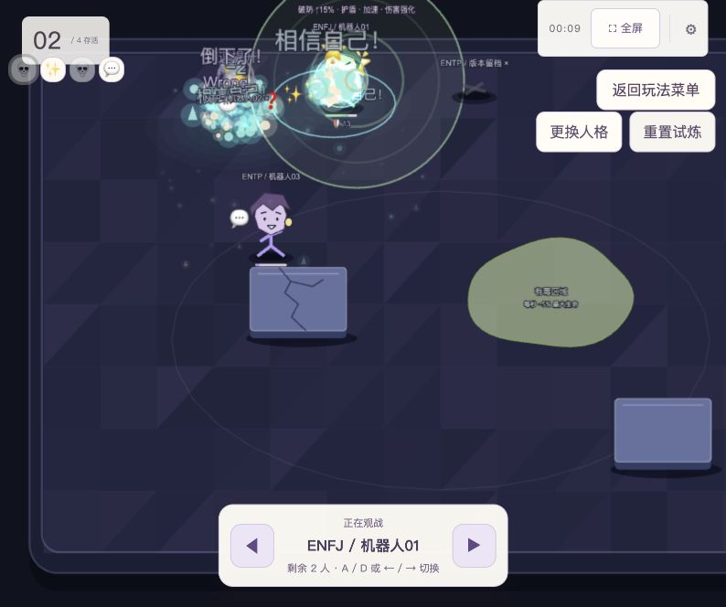
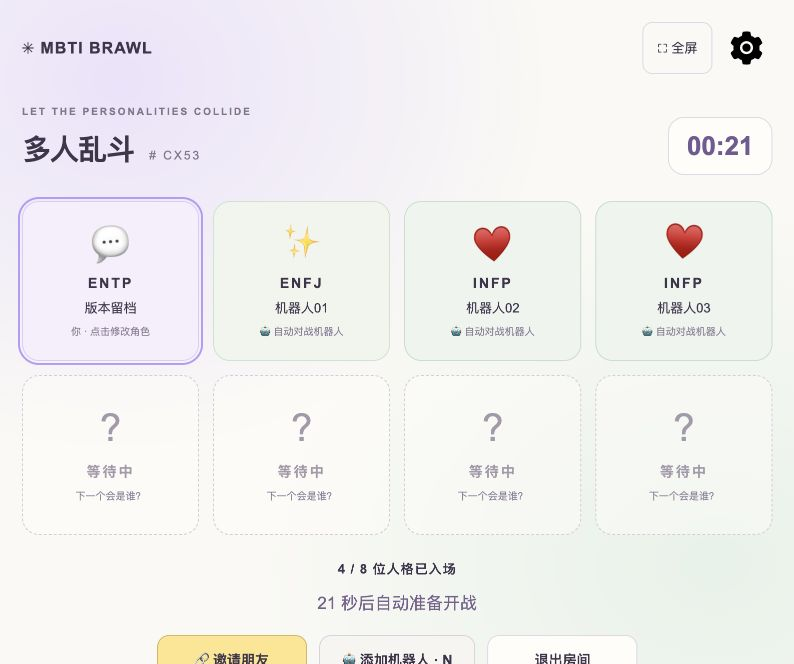

# MBTI 大乱斗当前版本记录

## 版本概览

当前版本已形成从创建人格、选择玩法、进入战斗到淘汰观战和赛后再战的游戏流程。玩法核心是以 MBTI 人格为主题的俯视角自由混战，结合人格技能、机器人对手、随机场地和可破坏掩体。

记录日期：2026 年 10 月 29 日（北京时间）。归档标识：2026-10-29 工作区快照。package.json 版本为 0.1.0；战斗设计沿用 Combat Master V0.2；当前代码网络协议为 16。Git 基准为 d14090cd077f5b0ad670ca82da3acadd9c01fa96，当前工作区另有未提交修改，因此仅检出此提交不能还原本次记录的完整状态。

## 主要界面与功能

以下图片均为本次从本机 http://localhost:3000 实际运行页面新截取，视口为 794 × 664。截图保留原始界面与可视区域，较长页面的下方内容可能需要滚动；随机地图、人格组合和房间号仅代表截图时的状态。

## 欢迎与角色创建

欢迎页通过 Enter 进入角色创建。玩家可以从 16 型 MBTI 中选择人格，设置 1 至 12 字昵称，随后进入玩法菜单。人格资料支持后续修改。

*欢迎页*

*角色创建*

## 玩法菜单与人格浏览

主菜单展示当前人格卡、昵称、人格武器及三个玩法入口。试炼场和多人乱斗可进入；小小花园显示 Coming Soon，尚未开放。人格浏览页提供全部 16 型的卡片与技能档案。

*玩法菜单*

*人格浏览 可向下滚动查看其余人格*

## 试炼与战斗主界面

独立试炼支持选择 2、3、5 或 7 名机器人对手，战斗内可更换人格、重置试炼及返回菜单。战场显示存活人数、玩家头像状态、计时、人格档案、生命与人格能量。开场有 3 秒倒计时。

当前美术已接入紫蓝几何地面、立体掩体阴影、角色面容与轻微形变、薄荷色粒子和冲击波。画质设置提供高、中、低三档粒子预算 512、256、96；技能文字、Emoji 和范围效果用于表达攻击及状态。

*试炼战场与开场倒计时*

## 淘汰与观战

玩家淘汰后显示名次和击杀者，可立即继续观战，也会在短暂等待后自动进入。观战镜头跟随存活玩家，可用按钮、A / D 或左右方向键切换目标，目标淘汰后自动换人。本次实机截图捕获了淘汰提示、自动观战、技能特效和掩体裂纹。

*淘汰提示*

*实战观战 技能特效与受损掩体*

## 多人大厅

多人模式支持创建房间、输入房间号加入、邀请朋友及最多 8 人同场，允许重复人格。大厅可修改自己的角色，添加测试机器人；至少 2 人时开始等待倒计时，满员缩短等待，也可按 Enter 快速开局。正式比赛以最后存活者为冠军。

*多人大厅 1 位真人与 3 位测试机器人*

## 本周胜场榜

主菜单提供本周胜场榜。多人乱斗真人冠军每局增加 1 胜，同胜场并列；试炼、平局和机器人获胜不计入。按北京时间周一 00:00 划分统计周，展示前 100 位。当前按昵称累计，同名合并、改名分开。截图时本周榜单为空，未生成虚构战绩。

*本周胜场榜 空状态*

## 当前实现的系统

16 人格：ENTP、INFP、ESTJ、ESTP、INTJ、INTP、ENTJ、INFJ、ENFJ、ENFP、ISTJ、ISFJ、ESFJ、ISTP、ISFP、ESFP 均有普攻、技能、大招与特质定义，包含远程、近战、护盾、推拉、传送、标记、炮台及随机效果等机制。

随机地形：提供 Open、Normal、Maze、Muddy、Toxic、Chaos 六种组合，可通过种子复现。泥潭使移动速度降至 60%，毒区每秒造成最大生命值 5% 的环境伤害，离开即停止；试炼提供地形调试，F3 可查看调试信息。

可破坏掩体：小、中、大掩体耐久为 20、30、50；每次有效普攻造成 10 点掩体伤害，对应 2、3、5 次击碎。受损以渐进裂纹表现，击碎出现碎屑并立即解除碰撞，界面隐藏掩体血条和 HP 数字。技能按配置参与掩体伤害与穿透判定。

比赛闭环：代码及现有实施记录包含淘汰排序、冠军庆祝、战绩表、趣味称号和原房间再来一局。战绩覆盖名次、击杀、伤害、存活时间；重赛保留在线玩家身份与测试机器人，重建场地及战斗状态。本次未重新截取冠军和结算页面。

联机与存储：Phaser 3、TypeScript、Vite 前端，Node.js 与 Socket.IO 服务端，每个房间独立模拟。周榜使用本地 JSON 持久化，支持 BRAWL_DATA_DIR 指定目录。房间本身不在 Host 重启后保留。

## 操作方式

电脑：WASD 移动，鼠标瞄准，左键普攻，右键技能，空格在能量满足时释放大招。大厅 N 添加机器人，Enter 跳过等待。

触屏：设置中开启触屏控制，左摇杆移动，右摇杆瞄准并松手攻击；技能按类型点击或拖动释放。真实手机联机与性能仍需在目标设备验收。

## 功能边界与备份说明

小小花园尚未开放；道具系统目前仅发现设计文档，未计入已完成功能。机器人为基础测试 AI，没有难度选择。没有账号身份系统，周榜按昵称聚合；完整历史比赛存档尚未建立。Windows、Electron 及手机的性能需要目标设备实测。

本次完成的是界面与功能记录，实际走查了欢迎、角色创建、人格浏览、试炼战斗、淘汰观战、多人建房及机器人加入、周榜空状态；未重新执行全量自动化测试，也未进行多真人联机验收。其余系统说明依据当前源码和实施记录整理。

此文件夹包含单文件 HTML 图文版、Markdown 源文档、原始 JPEG 截图及版本清单。HTML 已内嵌图片，单独复制即可离线查看。此归档不包含完整源代码、依赖或排行榜数据；恢复可运行版本还需另行保留当前工作区和 data 目录。

## 参考位置

README.md；src/shared/characters/CharacterDatabase.ts；src/shared/terrain/TerrainConfig.ts；src/shared/GameConstants.ts；src/main.ts；docs/report/DESTRUCTIBLE_COVER_REPORT.md；docs/report/GAME_ART_PRESET_V1_REPORT.md；docs/report/M5_REMATCH_REPORT.md。
